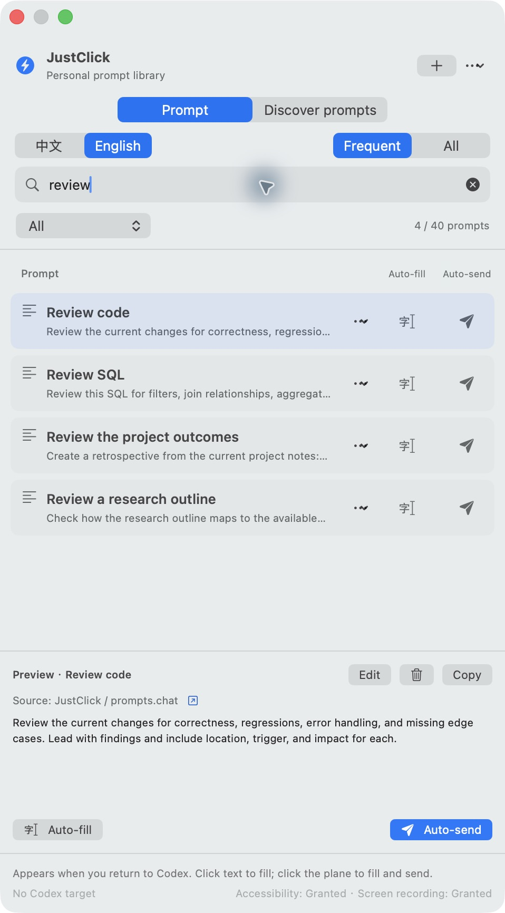
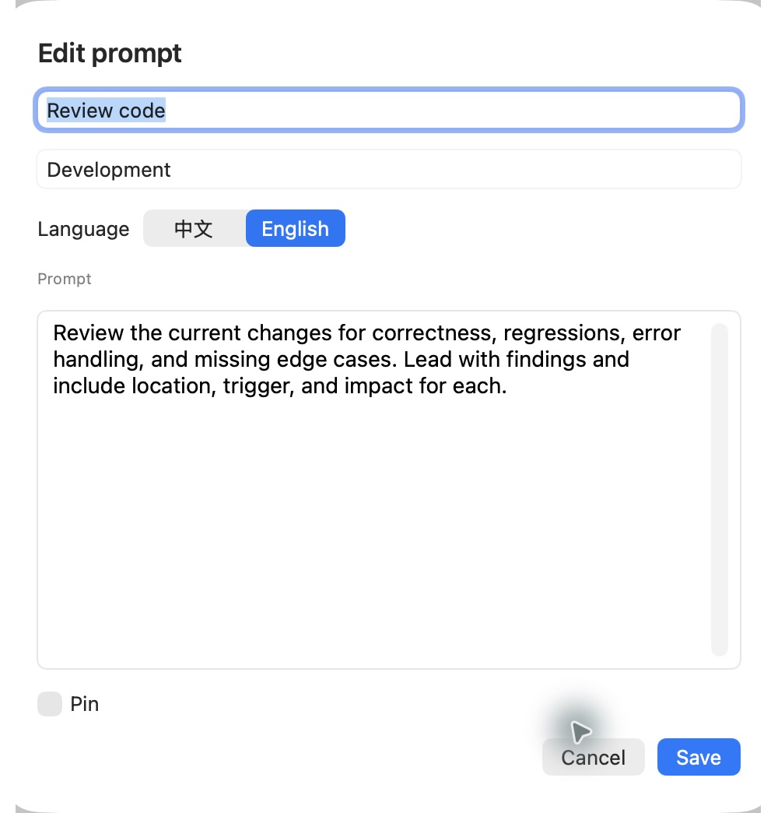

<div align="center">

# JustClick

### Your prompts. One click into Codex.

A macOS sidebar to save, discover, and reuse the prompts you reach for every day.

**English** · [简体中文](README.zh-CN.md)

[Get started](#get-started) · [Features](#what-you-can-do) · [History discovery](#your-history-your-shortcuts) · [How it works](#under-the-hood)


</div>

You already know the prompts that work: *continue the task, review this code, explain the error, summarize the progress.*

**Keep them beside Codex. Click to fill. Choose when to send.**

<table>
  <tr>
    <td align="center" width="50%"><strong>Your everyday prompt library</strong></td>
    <td align="center" width="50%"><strong>Discover what you already use</strong></td>
  </tr>
  <tr>
    <td valign="top"></td>
    <td valign="top"></td>
  </tr>
</table>

<sub>Actual screenshots of the running macOS app. The history example is Chinese; the interface and starter library support both Chinese and English.</sub>

## What you can do

| You want to… | JustClick gives you… |
|---|---|
| Reuse a good instruction | A prompt library beside your Codex window. |
| Check wording before submitting | **Auto-fill** inserts the prompt without sending it. |
| Keep a task moving | **Auto-send** fills, verifies, and requests submission. |
| Find your own repeatable workflows | Local history discovery with a **review → select → add** workflow. |
| Start with useful prompts | **40 Chinese + 40 English** curated prompts for development, writing, translation, research, data, and everyday work. |
| Keep the right prompts close | Pin favorites; let local usage bring frequent prompts forward. |
| Make the library yours | Search, edit, duplicate, categorize, import, export, and delete with a backup. |
| Fit your workspace | Adaptive window sizing, native edge resizing, and remembered dimensions. |

### Two actions. Clear intent.

- **Text cursor — Auto-fill:** insert into the current Codex composer so you can review or edit.
- **Paper plane — Auto-send:** insert and verify the prompt, then use an identified send control or Enter.
- **Click a prompt's text:** defaults to Auto-fill. Copy remains a separate action.

An unconfirmed result stays unconfirmed. JustClick reports it rather than silently retrying. You can keep browsing and editing the library.

## Your history, your shortcuts

Your most useful prompt collection may already be in your conversations.

1. Open **Discover prompts**.
2. Click **Read history** to analyze local Codex chats.
3. Review the wording, usage count, and number of chats.
4. Select the suggestions you want, then click **Add selected**.

**Reading history does not change your library.** Previously added entries are marked, and repeated imports preserve edits and avoid duplicates.

Discovery uses the official Codex App Server through your installed CLI. It extracts user text, filters common automation markers and unsuitable content, and favors repetition across chats. Suggestions are heuristic, so you remain in control of what gets added.

The current reader examines up to 500 indexed local chats per run. Limits and read failures are reported; other devices, unindexed files, and ChatGPT Work history are not assumed to be covered. It runs on demand—no continuous history hook is installed.

[Read the implementation and coverage notes →](docs/codex-history-personalization.md)

## Find it. Refine it. Reuse it.

Search across titles, bodies, and categories—even when the home view is showing only your frequent prompts. Edit the exact wording, choose its language, and pin it for next time.

<table>
  <tr>
    <td align="center" width="50%"><strong>Search the whole current-language library</strong></td>
    <td align="center" width="50%"><strong>Edit the prompt, not a config file</strong></td>
  </tr>
  <tr>
    <td valign="top"></td>
    <td valign="top"></td>
  </tr>
</table>

### English or 中文, one switch away

The language switch updates the main interface and selects the matching starter prompts. Your custom wording is preserved, and each prompt can have its own language.

<p align="center">
  
</p>

## Get started

### Requirements

- **macOS 14 or later.** JustClick is a native macOS app.
- **Codex desktop** for filling and sending prompts.
- **A Swift 6 toolchain** to build from source.
- **Codex CLI + Python 3** for optional history discovery. The current adapter detects common Homebrew/system installation paths.

### Build and install

From the repository directory:

```sh
./scripts/build-app.sh

# Quit any running JustClick instance before updating.
./scripts/install-app.sh

open "$HOME/Applications/JustClick.app"
```

The build produces `dist/JustClick.app`. The installer uses the fixed path `~/Applications/JustClick.app` and backs up an existing copy before replacing it.

Local builds use ad-hoc signing by default. Rebuilding may invalidate macOS permissions; a consistent signing certificate can be supplied with `JUSTCLICK_SIGNING_IDENTITY`.

### First use

1. Open JustClick and your intended Codex chat.
2. Grant **Accessibility** access when prompted. **Screen Recording** is needed for visual fallback detection.
3. Pick a prompt and click the text cursor to fill, or the paper plane to fill and send.

**Control + Option + P** opens the prompt panel when the shortcut is available. The menu bar also provides access. Automatic following and launch at login are configurable.

| Permission | Used for |
|---|---|
| Accessibility | Finding/focusing the composer and dispatching input. |
| Screen Recording | Local screenshot-based detection when accessibility lookup cannot locate the composer. |
| Neither | Browsing, editing, and copying prompts. History discovery reads local data through the CLI. |

## Under the hood

```text
Prompt selected
    → restore the original focus or locate the composer
    → fall back to local + / microphone icon matching when needed
    → paste normally
    → verify the text
    → optionally request submission and check the result
```

- **Native interface:** SwiftUI in an AppKit companion panel.
- **Local visual fallback:** icon matching plus Apple's Vision text recognition.
- **Position cache:** rechecks window geometry and small layout fingerprints before reusing a location.
- **Local library:** JSON in `~/Library/Application Support/JustClick/`, with backups before destructive library changes.
- **History discovery:** read-only App Server methods; candidate reports remain on your Mac. JustClick does not call a cloud model to analyze them.

Sending a prompt uses Codex's normal processing. **This is an independent companion, not an embedded Codex plugin.** UI automation depends on the Codex layout, focus, permissions, and keyboard settings; an Enter keypress is not itself proof of successful submission.

<details>
<summary><strong>Development checks and implementation notes</strong></summary>

```sh
./scripts/check.sh
./scripts/check-paste.sh
python3 scripts/history/test_discover.py
```

The native checks exercise an isolated test window. Passing them does not establish compatibility with every Codex release.

- [Verification log](docs/verification.md)
- [Local icon matching](docs/icon-matching.md)
- [History discovery design](docs/codex-history-personalization.md)
- [Input-method comparison](docs/input-methods.md)
- [Archived engineering notes — 中文](docs/engineering-notes.zh-CN.md)
- [Screenshot provenance](docs/images/README.md)

</details>

## Prompt sources

The starter collection combines JustClick's short workflow prompts with adapted scenarios inspired by:

- [prompts.chat](https://github.com/f/prompts.chat) — prompt data under CC0.
- [best-prompts](https://github.com/xstongxue/best-prompts) — selected scenarios adapted under Apache-2.0.

Adaptations and translations are documented in [third-party notices](THIRD_PARTY_LICENSES/NOTICE.txt). This is a curated collection, not a mirror of either full catalog.

## Help make one click better

Useful contributions include reproducible composer failures, accessibility improvements, prompt translations, and clearer workflows. Include your macOS version, Codex version, and expected/actual behavior. Remove private conversation content from shared screenshots and logs.

If JustClick makes your daily workflow easier, a star or a shared use case helps others find it.

## License

[MIT](LICENSE) · Copyright (c) 2026 fendouai.

Third-party prompt content remains subject to its respective licenses and attribution requirements. See [third-party notices](THIRD_PARTY_LICENSES/NOTICE.txt).
