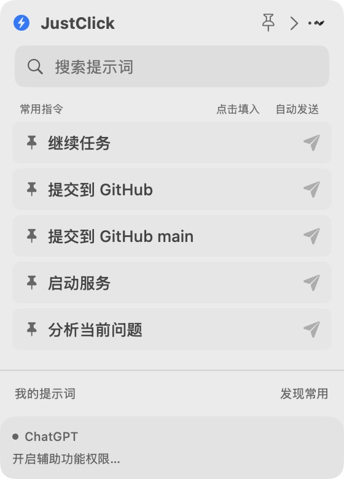
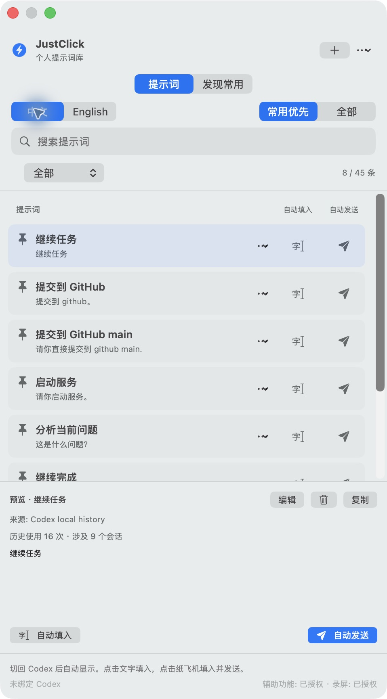
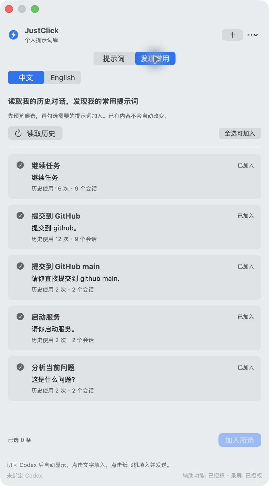
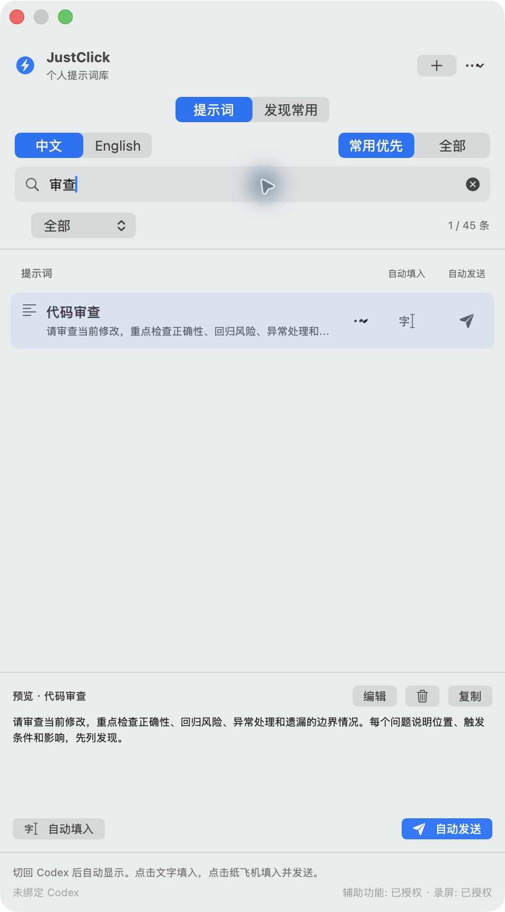
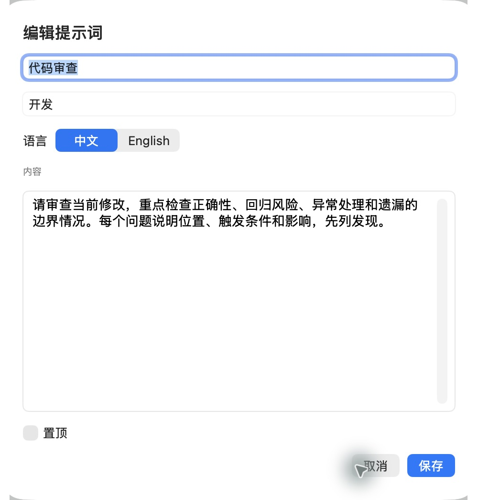
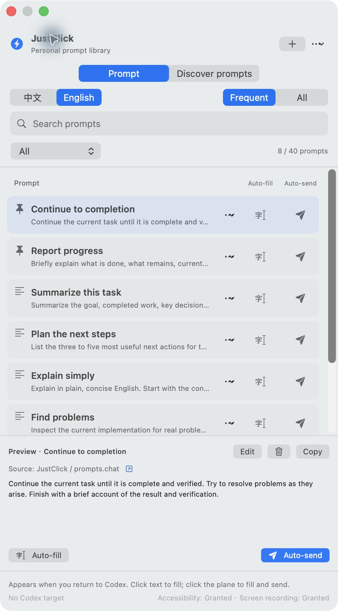

<div align="center">

# JustClick

### 更轻的工作方式

<p align="center"></p>

默认只显示 28 点的小图标，点击展开 280 点宽、5 条常用指令的临时菜单：点击名称填入，纸飞机发送。点击外部或按 Esc 收起；操作核对成功后也会收起，失败或回执不确定时保留反馈。固定展开可使用较大的 8 条指令面板；「仅菜单栏模式」可完全隐藏工作区入口。点击「我的提示词」打开完整管理窗口，点击「发现常用」进入候选审核标签页。使用次数变化不会使按钮跳位；通过「刷新常用排序」主动更新推荐。快捷搜索与管理窗口筛选互不影响。

底部显示已记住的目标窗口与操作状态。尚无目标或辅助功能权限时，自动发送不可用；每次点击仍会重新验证目标。

## 常用提示词，一键填入 Codex。

把每天都会用到的提示词，放在 Codex 旁边。

[English](README.md) · **简体中文**

[快速开始](#快速开始) · [功能一览](#你可以用它做什么) · [发现个人常用](#你的历史对话就是自己的提示词库) · [实现方式](#它是怎样工作的)


</div>

“继续任务”“检查代码”“解释这个问题”“汇报进度”——好用的提示词，往往也是反复输入的那些。

**把它们留在手边。点一下填入，再决定是否发送。**

<table>
  <tr>
    <td align="center" width="50%"><strong>常用提示词，随手可用</strong></td>
    <td align="center" width="50%"><strong>从自己的历史对话中发现常用</strong></td>
  </tr>
  <tr>
    <td valign="top"></td>
    <td valign="top"></td>
  </tr>
</table>

<sub>截图均来自实际运行的 macOS 应用，不是概念图。应用界面和内置提示词支持中英文切换。</sub>

## 你可以用它做什么

| 你想做的事 | JustClick 提供的功能 |
|---|---|
| 重复使用一条好指令 | 放在 Codex 旁边的提示词侧栏。 |
| 填入后再检查、修改 | **自动填入**：只填入，不发送。 |
| 一次点击继续工作 | **自动发送**：填入、核对，再请求提交。 |
| 找到自己的高频工作方式 | 本地历史发现，**先预览 → 再勾选 → 加入所选**。 |
| 开箱就有内容可用 | **中文40条 + 英文40条**，覆盖开发、写作、翻译、研究、数据与日常工作。 |
| 让重要内容排在前面 | 置顶收藏，并依据本地使用情况显示常用条目。 |
| 维护自己的提示词库 | 搜索、编辑、复制为新条目、分类、导入导出，以及删除前备份。 |
| 适应不同工作区 | 自动计算窗口尺寸，也可手动拖动缩放并记住大小。 |

### 两种操作，一眼分清

- **文字光标 · 自动填入**：填入当前 Codex 输入框，留给你检查和修改。
- **纸飞机 · 自动发送**：填入并核对后，操作可确认的发送按钮或按 Enter。
- **点击提示词正文**：默认自动填入；复制仍有独立入口。

结果无法确认时会明确提示，不会把一次键盘事件直接当作发送成功，也不会自动反复重试。提示词库仍可继续浏览和编辑。

## 你的历史对话，就是自己的提示词库

1. 切到 **发现常用** 标签页。
2. 点击 **读取历史**，分析本机 Codex 会话。
3. 查看候选正文、出现次数和涉及的会话数。
4. 勾选需要的内容，点击 **加入所选**。

**读取候选不会修改提示词库。** 已加入的内容会被标记，重复导入会保留手工修改并避免重复添加。

发现功能通过已安装的 Codex CLI 使用官方 App Server，提取用户文本、过滤常见自动内容与不适合的条目，并优先考虑跨会话重复使用的指令。筛选基于规则，候选仍需你判断。

当前每次最多处理500个已索引的本机会话，读取失败和范围限制会提示。其他设备、未索引文件及 ChatGPT Work 历史不默认包含在内。功能按需运行，不会安装持续采集 Hook。

[查看实现与覆盖范围说明 →](docs/codex-history-personalization.md)

## 找到它，改好它，下次直接用

搜索覆盖标题、正文和分类，即使首页只显示常用条目，也能查找当前语言的完整提示词库。编辑时可修改名称、分类、语言、正文和置顶状态。

<table>
  <tr>
    <td align="center" width="50%"><strong>搜索当前语言的完整提示词库</strong></td>
    <td align="center" width="50%"><strong>直接编辑，不必修改配置文件</strong></td>
  </tr>
  <tr>
    <td valign="top"></td>
    <td valign="top"></td>
  </tr>
</table>

### 中文或 English，一键切换

语言切换同步更新主要界面和对应的内置提示词。自定义内容保留原文，每条提示词也可以单独设置语言。

<p align="center">
  
</p>

## 快速开始

### 环境要求

- **macOS 14或更高版本**。
- **Codex 桌面应用**：用于填入与发送。
- **Swift 6工具链**：用于从源码构建。
- **Codex CLI + Python 3**：仅历史发现功能需要；当前适配常见 Homebrew / 系统安装路径。

### 构建并安装

在项目目录中执行：

```sh
./scripts/build-app.sh

# 更新前，请先退出正在运行的 JustClick。
./scripts/install-app.sh

open "$HOME/Applications/JustClick.app"
```

构建产物为 `dist/JustClick.app`。安装脚本固定使用 `~/Applications/JustClick.app`，替换已有版本前会备份。

本地构建默认采用临时签名，重新构建后可能需要更新 macOS 授权。可以通过 `JUSTCLICK_SIGNING_IDENTITY` 指定固定签名证书。

### 第一次使用

1. 打开 JustClick，以及准备使用的 Codex 聊天。
2. 按提示授予**辅助功能**权限；视觉定位兜底需要**屏幕录制**权限。
3. 点击光标图标填入，或点击纸飞机填入并发送。

快捷键 **Control + Option + P** 可打开面板，前提是未被其他应用占用。也可从菜单栏进入；自动伴随显示和登录时启动均可配置。

| 权限 | 用途 |
|---|---|
| 辅助功能 | 定位、聚焦输入框，以及执行输入操作。 |
| 屏幕录制 | 辅助功能定位失败时，使用本地截图进行视觉识别。 |
| 两者都不需要 | 浏览、编辑和复制提示词；历史发现通过 CLI 读取本地数据。 |

## 它是怎样工作的

```text
选择提示词
    → 恢复原焦点或定位输入框
    → 必要时用本地＋/麦克风图标匹配兜底
    → 正常粘贴
    → 核对文字
    → 按选择请求发送，并检查结果
```

- **原生界面**：SwiftUI + AppKit 伴随面板。
- **本地视觉识别**：图标匹配配合 Apple Vision 文字识别。
- **位置缓存**：复用前检查窗口与局部布局指纹，减少完整识别。
- **本地提示词库**：JSON 保存在 `~/Library/Application Support/JustClick/`，涉及删除等变更时先备份。
- **历史发现**：使用 App Server 的只读业务接口，候选报告保存在本机，不调用云端模型分析记录。

发送提示词后，由 Codex 按其正常方式处理内容。JustClick 是独立伴随应用；UI自动操作会受到 Codex 布局、焦点、权限和键盘设置影响，按下 Enter 不等于已经确认发送成功。

<details>
<summary><strong>开发检查与技术资料</strong></summary>

```sh
./scripts/check.sh
./scripts/check-paste.sh
python3 scripts/history/test_discover.py
```

原生检查使用独立测试窗口，通过检查不代表兼容所有 Codex 版本。

- [验证记录](docs/verification.md)
- [本地图标匹配](docs/icon-matching.md)
- [历史发现设计](docs/codex-history-personalization.md)
- [输入技术方案比较](docs/input-methods.md)
- [原 README 工程记录](docs/engineering-notes.zh-CN.md)
- [截图来源说明](docs/images/README.md)

</details>

## 提示词来源

内置库包含 JustClick 自身的简短工作指令，以及参考以下项目整理、改编的场景：

- [prompts.chat](https://github.com/f/prompts.chat)：提示词数据采用 CC0。
- [best-prompts](https://github.com/xstongxue/best-prompts)：部分场景按 Apache-2.0 许可改编。

具体改动、翻译及许可见[第三方说明](THIRD_PARTY_LICENSES/NOTICE.txt)。这里提供精选条目，并非两个上游仓库的完整镜像。

## 一起把“一键”做好

欢迎提供可复现的定位问题、辅助功能改进、翻译或更清晰的工作流程。反馈时附上 macOS / Codex 版本、预期与实际结果；分享截图和日志前请移除私人对话内容。

如果 JustClick 帮你省下了重复输入，欢迎点一个 Star，或分享你的实际用法。

## 许可证

[MIT](LICENSE) · Copyright (c) 2026 fendouai。

第三方提示词内容继续遵守各自的许可证与署名要求，详见[第三方说明](THIRD_PARTY_LICENSES/NOTICE.txt)。
